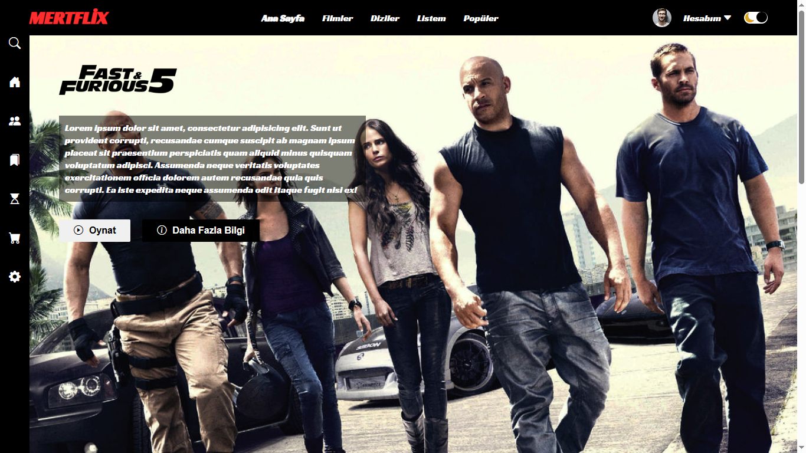

# 🎬 Film Sitesi Projesi

Film Sİtemiz, film severlerin sevdikleri filmlere kolayca ulaşabilmesi, popüler yapımları keşfedebilmesi ve gündemdeki filmleri takip edebilmesi için hazırladığım bir web sitesi projesidir.

Projede önceliğim, kullanıcıların karmaşık menülerle uğraşmadan aradıkları filmlere ulaşabilecekleri, sade ve kullanışlı bir arayüz oluşturmaktı.

## 🌟 Öne Çıkan Özellikler

- **Basit ve Kullanıcı Dostu Arayüz:** Filmlere kolay ve hızlı erişim sağlayan sade tasarım.
- **Popüler Filmler:** Kullanıcıların en çok ilgi gören filmleri keşfedebileceği bölüm.
- **Gündemdeki Filmler:** Güncel olarak dikkat çeken ve konuşulan filmleri inceleme imkânı.
- **Öne Çıkan Filmler:** Dikkat çekici yapımların ön plana çıkarıldığı özel alan.
- **Gündüz ve Gece Modu:** Kullanıcıların tercihlerine göre açık veya koyu tema arasında geçiş yapabilmesi.

## 🛠️ Kullanılan Teknolojiler

- HTML5
- CSS3

## 📸 Projeden Görüntüler

## 💻 Projeyi Bilgisayarınıza İndirin

Projeyi kendi bilgisayarınızda incelemek veya geliştirmek isterseniz:

1. GitHub reposunun ana sayfasına gidin.
2. Yeşil **Code** butonuna tıklayın.
3. **Download ZIP** seçeneğini seçin.
4. İndirdiğiniz dosyayı klasöre çıkarın.
5. Projeyi VS Code ile açın.
6. `index.html` dosyasını tarayıcınızda çalıştırın.

## 🎯 Projenin Amacı

Bu projeyi HTML, CSS ve JavaScript bilgilerimi geliştirmek, öğrendiklerimi gerçek bir web sitesi üzerinde uygulamak ve frontend geliştirme alanında deneyim kazanmak amacıyla hazırladım.

Geliştirme sürecinde tasarım, kullanıcı deneyimi, sayfa düzeni ve etkileşimli özellikler üzerinde çalıştım.

Projeyi ilerleyen süreçte yeni özelliklerle geliştirmeye devam edeceğim.

---

⭐ Projeyi beğendiyseniz GitHub üzerinden yıldız vererek destek olabilirsiniz!
